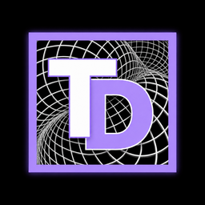
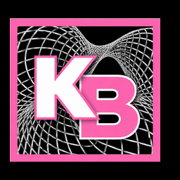

[English](README.md) · **Deutsch**

  

  
  &nbsp;
  
  &nbsp;
  
  &nbsp;
  

<h1 align="center">ThreadDesk</h1>

<strong>Ein Arbeitsplatz, der den Stand deiner KI-Projekte behält.</strong>

ThreadDesk hält Ideen, Entscheidungen, Notizen und Dateien bei ihrem Projekt. Du kannst zwischen Aufgaben wechseln und später dort weitermachen, wo du aufgehört hast.

**Veröffentlicht: [0.1.1rc1](https://github.com/landjunge/threaddesk/releases/tag/v0.1.1rc1) · 2. Oktober 2026 · Vorabversion**

[macOS Intel herunterladen](https://github.com/landjunge/threaddesk/releases/download/v0.1.1rc1/ThreadDesk-macOS.dmg) · [macOS Apple Silicon](https://github.com/landjunge/threaddesk/releases/download/v0.1.1rc1/ThreadDesk-macOS-AppleSilicon.dmg) · [Windows](https://github.com/landjunge/threaddesk/releases/download/v0.1.1rc1/ThreadDesk-Windows.exe)

Prüfsummen und Herkunftsbelege stehen bei den [Downloads](https://github.com/landjunge/threaddesk/releases/tag/v0.1.1rc1). Windows-Weiterentwicklung ist vorläufig pausiert; der vorhandene Download bleibt verfügbar.

## Was heute vorhanden ist

- **Projektkontext:** Threads, Notizen, Zwischenstände, Wissenskarte und Whiteboards lokal verwalten.
- **Lokale KI:** optional Ollama mit einem selbst gewählten Modell verwenden.
- **Zusammenarbeiten:** ausdrücklich freigegebene Whiteboard-Einträge zwischen lokalen Installationen austauschen.
- **Sichern:** den Arbeitsbereich exportieren und eine Sicherung als eigenen Bereich öffnen.

**Zusätzlich im aktuellen Quellstand:** Bibliotheksimport, lokale Suche, revisionsgeprüfte Änderungen sowie zugeordnete Übergaben, Rückfragen und Ergebnisse über MCP. Diese Erweiterungen sind nicht automatisch im Desktop-Download enthalten. Ein vorbereiteter Auftrag startet keinen externen Agenten; eine Lieferung braucht weiterhin deine Abnahme. [Details und Grenzen](docs/DEVELOPERS.md).

## Loslegen

1. **Installieren.** Lade die passende Datei. Auf macOS öffne die DMG und ziehe ThreadDesk nach „Programme“; auf Windows öffne die EXE. Python ist enthalten.
2. **Thread anlegen.** Benenne dein Projekt und ergänze eine Notiz oder Datei.
3. **Stand festhalten.** Speichere einen Zwischenstand und probiere unter „Daten“ die Sicherung aus.

Die Oberfläche spricht Deutsch und Englisch. Die macOS-App ist nicht Apple-notarisiert. Backups enthalten private Inhalte und Raum-Zugangsdaten; extern verlinkte Dateien gehören nicht dazu. Der Raum-Austausch ist lokal, kein fertiger Internetdienst.

Die optionale lokale KI darf ohne ausdrückliche Freigabe keine Benutzeroriginale löschen, externe Dienste nutzen oder auf Geheimnisse zugreifen. Modellwahl und Rechnerressourcen bleiben unter deiner Kontrolle. [Bedienung, Sicherung und KI-Grenzen](docs/DEVELOPERS.md).

## Geplante Zusammenarbeit

Die fünf Produkte bleiben eigenständig. Geplant ist ein gemeinsamer Ablauf mit **KiraBridge als Kommunikationszentrale**:

| Produkt | Aufgabe im gemeinsamen Ablauf |
| --- | --- |
| [ThreadDesk](https://github.com/landjunge/threaddesk/blob/docs/product-family-readme-20261031/README.de.md) | Bewahrt Projektstand, Wissen und Ergebnisse. |
| [KiraBridge](https://github.com/landjunge/KiraBridge/blob/docs/product-family-readme-20261031/README.de.md) | Vermittelt Aufträge, Rückfragen und Antworten zwischen Chat, lokalen Agenten und Werkzeugen. |
| [4AllPass](https://github.com/landjunge/4AllPass/blob/docs/product-family-readme-20261031/README.de.md) | Verwaltet Zugangsdaten; soll gezielt erlaubte Zugriffe ermöglichen. |
| [TollGate](https://github.com/landjunge/tollgate/blob/docs/product-family-readme-20261031/README.de.md) | Prüft angeschlossene Aufrufe und setzt Verbrauchsgrenzen und Stopps durch. |
| [Agent Authority](https://github.com/landjunge/agent-authority-lab/blob/docs/product-family-readme-20261031/README.de.md) | Zeigt Beobachtungen, Widersprüche und fehlende Belege; erteilt keine Freigaben. |

Einzelne Schnittstellen sind vorhanden. Ein vollständig eingerichteter und geprüfter Ablauf aller fünf Produkte ist noch geplant. Freigaben bleiben beim zuständigen Werkzeug und beim Menschen. KiraBridge und Agent Authority benötigen Zugriff auf ihre privaten Repositorys.

[Benutzeroberfläche](docs/UI.md) · [Lokale Inhaltssuche](docs/LOCAL-SEARCH.md) · [MCP und Entwicklerdokumentation](docs/DEVELOPERS.md) · [Produktseite](https://threaddesk.netzwerkpunkt.de/)

## Lizenz und Mitwirkung

Private, nicht geschäftliche Nutzung ist unter der [Netzwerkpunkt Personal Use License 1.0](LICENSE) kostenlos. Geschäftliche Nutzung benötigt eine gesonderte schriftliche Erlaubnis. Der deutsche Lizenztext ist maßgeblich; historische Lizenzrechte bleiben erhalten.

Produktidee und Architektur: **Daniel Filipek (landjunge)**. KI unterstützt Implementierung und Dokumentation. Rückmeldungen und nachvollziehbare Reviews sind willkommen.
